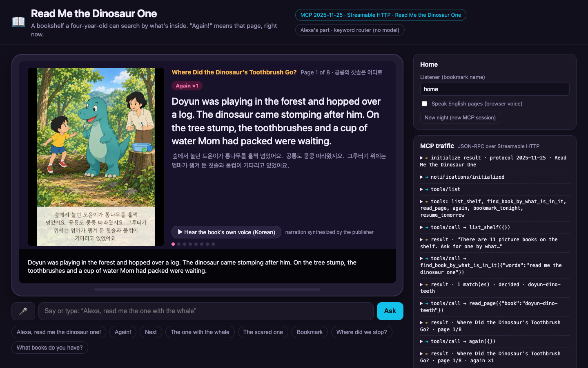

# Read Me the Dinosaur One

**An Alexa+ bookshelf where a four-year-old picks tonight's picture book by what's in it, not by its title, and "Again!" means that page, right now.**

A self-hosted MCP server (Streamable HTTP, MCP spec **2025-11-25**, built on `@modelcontextprotocol/sdk` 1.32) plus a web simulator that acts as a real MCP client (initialize, tools/list, tools/call) and plays the Alexa+ side with an Echo-Show-style screen.

Built for the Amazon Developer Hackathon, Alexa+ track. Code is MIT; the eleven sample books belong to their publisher (see [Data](#data-eleven-sample-picture-books)).



## What it does

A small child does not know titles. They know there is a dinosaur in it, or that the bunny goes to school. So:

```
Child:  Alexa, read me the dinosaur one!
Alexa:  Found it: Where Did the Dinosaur's Toothbrush Go? Page one. Doyun was playing in the forest
        and hopped over a log. The dinosaur came stomping after him. ...
Child:  Again!
Alexa:  (the same page, once more; the card now says "Again ×1")
Child:  Next
Alexa:  "Let's brush our teeth, you too!" Doyun held out the blue toothbrush. ...
Child:  The one with the whale
Alexa:  I have 2 books with whale: number one, At the End of the Blue Ribbon, a new baby arrives in a home
        up in space ... and number two, Luna the Dreaming Whale and Little Fear, a baby whale who is scared
        of the deep sea ... Which one?
Child:  The second one
Alexa:  Luna the Dreaming Whale and Little Fear. Page one. ...
Parent: Bookmark.
Alexa:  Bookmarked Luna the Dreaming Whale and Little Fear, page five of eight. Page five was the one you
        asked for again, twice; I'll remember that. Tomorrow, just say "where did we stop".

(next evening, a new session)
Child:  Where did we stop?
Alexa:  Last time we stopped at page five of Luna the Dreaming Whale and Little Fear. Page five was the one
        you asked for again, twice. Here it is. "Little Fear." Luna said its name out loud for the first time. ...
```

Three things the server keeps that a one-shot Q&A add-on would not:

- **A reading session.** One MCP session is one evening on the couch: which book is open, which page, what the last search offered ("the second one" works).
- **"Again!" is counted per page.** The page a child asks for twice is the page they love. The bookmark remembers it and says so the next day.
- **A bookmark that outlives the session.** `bookmark_tonight` writes a tiny JSON file; `resume_tomorrow` in a brand-new session reads it back, per listener name, even after the server restarts.

Every page card also carries the original Korean text and the book's own Korean narration (mp3 with sentence timestamps). On a screen, the simulator shows the page picture, the English text that Alexa speaks, the Korean underneath, and a button to hear the book's own voice with the sentence being read highlighted.

## Architecture

```
  Alexa+ side (simulated)                         MCP server (this repo)
 ┌──────────────────────────────┐                ┌──────────────────────────────────────────┐
 │ web/index.html  (Echo-Show   │  initialize    │ src/server.js   express + Streamable HTTP │
 │   style screen, page card,   │  tools/list    │   POST/GET/DELETE /mcp, one session =     │
 │   shelf, choices, caption)   │  tools/call    │   one Reading; Origin check               │
 │ web/app.js      keyword      │ ─────────────► │ src/mcp.js      6 tools + 2 resources,    │
 │   router: "again" -> again,  │  JSON-RPC 2.0  │   zod schemas, outputSchema, annotations  │
 │   "next" -> read_page, ...   │ ◄───────────── │ src/reading.js  session state, speech     │
 │ web/mcp-client.js  60-line   │  structured    │ src/shelf.js    find by creature/theme/   │
 │   MCP client (fetch + SSE)   │  Content       │   place/color; synonyms for child words   │
 │ <audio> Korean narration     │                │ src/bookmarks.js  JSON file, per listener │
 └──────────────────────────────┘                └───────────────┬──────────────────────────┘
          │ GET /media/...                                        │ reads
          ▼                                                       ▼
   data/media/pages/<slug>/p00..p09.jpg          data/books.json (11 books × 8 pages: ko, en, image, audio)
   data/media/audio/<slug>-p<n>.mp3              data/english.mjs (English retelling + tags, written for this project)
   data/media/covers/<slug>.webp                 data/bookmarks.json (created at runtime, git-ignored)
```

Alexa's part in the simulator is a **keyword router** (`plan()` in `web/app.js`): a few regular expressions decide which tool to call. No language model is called anywhere in this project. The router is deliberately dumb so that everything interesting (finding by content, the question when two books tie, counting "again", bookmarks) lives in the MCP server where a real Alexa+ would reach it through `tools/call`.

The simulator shell (the small MCP client and the traffic panel) and the Express/Streamable HTTP server scaffold (session map, Origin check) are shared with my other entry, Gotta Go. Everything else, tools, data, session logic, screen, is specific to this project.

## Run it

Requires Node 20+ (developed on Node 26). No keys, no network calls, no services.

```bash
npm install
npm start            # http://127.0.0.1:8790  (MCP endpoint: POST /mcp)
npm test             # 18 tests: shelf search, reading session, and an end-to-end run with the official MCP client
```

Open http://127.0.0.1:8790 and type or click: "Alexa, read me the dinosaur one!", "Again!", "Next", "The one with the whale", "The second one", "Bookmark", then press **New night** and ask "Where did we stop?". The right-hand panel shows every JSON-RPC message. In Chrome, the microphone button uses the Web Speech API for input; the "Speak English pages" checkbox uses the browser's speech synthesis for output.

Environment: `PORT` (default 8790), `HOST` (default 127.0.0.1), `BOOKMARKS_FILE` (default `data/bookmarks.json`), `ALLOWED_ORIGINS`.

Talk to it with any MCP client, for example the Inspector CLI:

```bash
npx @modelcontextprotocol/inspector --cli http://127.0.0.1:8790/mcp --transport http --method tools/call \
  --tool-name find_book_by_what_is_in_it --tool-arg words="the one where the bunny goes to school"
```

## Tools

| Tool | What it does | Returns (structuredContent) |
|---|---|---|
| `list_shelf` | The eleven books with what is in each one | `books[]`, `menu{creatures,themes}`, `speech` |
| `find_book_by_what_is_in_it` `{words}` | Finds books by creatures ("dinosaur", "bunny"), what happens ("brushing teeth", "a new baby", "first day of daycare"), places, colors; Korean title words work too | `results[]` best first with `why`, `decided`, `unmatched`, `speech` (a question when two books tie) |
| `read_page` `{book? \| choice?, page?}` | Opens a book at page 1 (`book` = slug, or `choice` = n-th book the last search offered), or turns to the next page, or jumps to `page` | a page card: `text_en` (to speak), `text_ko`, `image`, `audio{src,sentences[]}`, `page`, `pages`, `again_count`, `is_last`, `speech` |
| `again` | Re-reads the same page and counts it | the same page card with `again_count` + 1 |
| `bookmark_tonight` `{listener?}` | Saves book, page, finished flag and the again-counts to a JSON file | `bookmark`, `listener`, `speech` |
| `resume_tomorrow` `{listener?}` | Opens the bookmarked book at the bookmarked page (page 1 if it was finished) and reads it, naming the page asked for again | a page card + `bookmark` |

Resources: `storyshelf://reading` (what this session remembers) and `storyshelf://about` (where the books come from). The server's `instructions` tell the host the voice rules: one page per turn, speak `speech` almost verbatim, never ask for a title, never claim the listener's child made the book. `skills/storyshelf/SKILL.md` says the same as an Agent Skill.

Errors are tool results with `isError: true` and a spoken sentence ("Nothing has been read yet. Ask for a book first."), never exceptions.

## Data: eleven sample picture books

- **Books:** the eleven sample books on the public shelf of [Dongwhamoa](https://dongwhamoa.com) (MoaHub, Korea), a service that makes one-of-a-kind picture books for a child. These are *sample books created by Dongwhamoa* for its shelf; their text, pictures and narration were generated with AI tools and edited by the publisher, and the child characters in them are invented. They are not books made by real customers, and no customer data is in this repository.
- **Narration:** `data/media/audio/*.mp3` is the books' own Korean narration, synthesized with an on-device text-to-speech model by the publisher, with per-sentence timestamps.
- **Page pictures:** rendered from the publisher's PDFs with `scripts/render-pages.swift` (PDFKit, macOS), 768 px wide JPEG: `p00` is the cover, `p01`–`p08` the eight pages, `p09` the end page (110 images for 11 books).
- **English text and tags:** `data/english.mjs` was written for this project: a read-aloud English retelling of each of the 88 pages and the creature/theme/place/color tags the search uses, drafted with an AI writing assistant and edited by me, sentence by sentence against the Korean. No translation API is called; Korean is the original.
- **Build:** `node scripts/build-data.mjs` merges the publisher's `manifest.json`, `texts.json` and `audio/manifest.json` with the English layer into `data/books.json` and copies the media. The output is committed (about 34 MB), so the repo runs without the source files.

**License of the data:** the books (text, pictures, narration, covers) are © 2026 MoaHub / Dongwhamoa and are included here so the project can be run and judged. They are **not** covered by the MIT license of the code (see `data/LICENSE-DATA`). Please do not redistribute them separately.

## What is not here (on purpose)

- No language model, no cloud call, no API key. The simulator's "Alexa" is a keyword router; a tool-calling model would make the same `tools/call` requests.
- No book generation. Dongwhamoa makes books with paid image and language models; this demo only reads the finished sample books.
- No customer books and no cloned voices. Dongwhamoa can narrate a book in a parent's recorded voice; that is private and stays out of this repo.
- No real Alexa+ device. Self-hosted MCP servers cannot be attached to a real Alexa+ by hackathon participants, so the web page is the MCP client, as the hackathon FAQ describes.

## What's next

- Let the MCP host play the narration itself (an `audio` content block) instead of the simulator's button.
- An MCP Apps view for the page card, so the picture and the Korean line render inside the Alexa+ conversation.
- Per-child shelves: a family's own Dongwhamoa books, with the parent's consent flow, behind the same six tools.
- Count "again" across nights and build a "most loved pages" card for parents.

## Tests

`npm test` runs `node --test`:

- `test/shelf.test.js`: data integrity (11 books × 8 pages, every page has Korean, English, a picture and narration), child-word synonyms, decided vs. tied searches, worries without a creature, Korean title words, unknown creatures.
- `test/reading.test.js`: open → next → again (count belongs to the page), picking "the second one", end of book, spoken errors, bookmark → resume in a new session from the file, finished book resumes from page one, the spoken shelf menu.
- `test/mcp-e2e.test.js`: starts the real server, connects with the official `@modelcontextprotocol/sdk` client over Streamable HTTP, checks the 2025-11-25 negotiation, the six tools with `outputSchema` and annotations, a full read with "again", that the page picture, narration and cover are actually served, foreign-origin rejection, session isolation, and a bookmark crossing sessions.

## License

MIT for the code (see `LICENSE`). Book data: see [Data](#data-eleven-sample-picture-books) and `data/LICENSE-DATA`.
